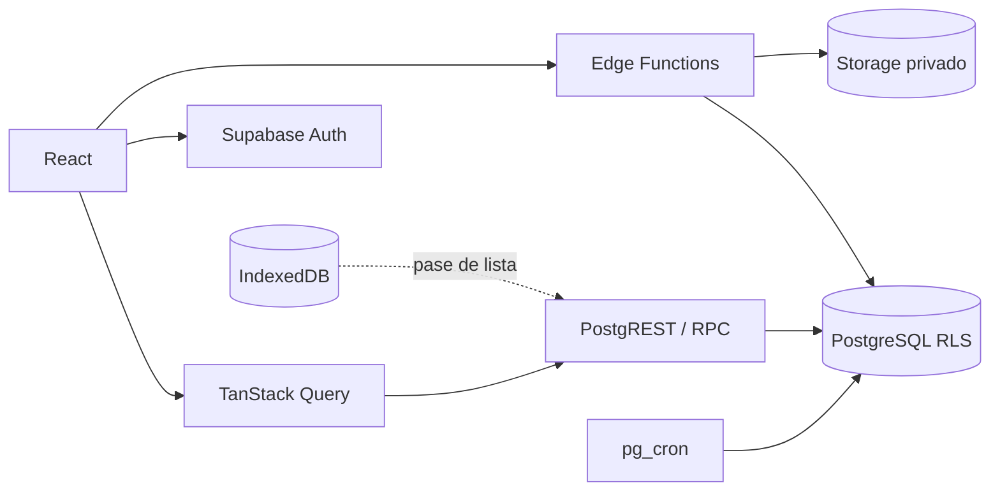

# Stack técnico

## Resumen
| Capa | Elección | Por qué |
|---|---|---|
| Frontend | React 19 + Vite + TypeScript estricto | SPA rápida, build estático y ecosistema |
| UI | Tailwind v4 + primitivas shadcn/ui | Control del diseño, accesibilidad y modo oscuro |
| Datos del cliente | TanStack Query | Caché, reintentos y estados de carga |
| Rutas | TanStack Router (código) | URLs propias para lista y detalle, sin codegen |
| Formularios | react-hook-form + zod | Validación en línea y borradores |
| PWA | vite-plugin-pwa | Instalación y cacheo del shell |
| Offline | Dexie (IndexedDB) | Cola del pase de lista |
| Backend | Supabase (PostgreSQL 15, Auth, Storage, Edge Functions) | RLS, Auth por invitación y despliegue simple |
| PDF | Edge Function + `pdf-lib` (Typst queda como diseño canónico) | Emisión funcional con folio y hash |
| Hosting | Cloudflare Pages | CDN, dominio propio y deploy manual |
| Pruebas | Vitest + Testing Library + Playwright + pgTAP | UI, reglas y RLS |

## Flujo de datos

## Decisiones de despliegue
- Una instancia por compañía; si otra quiere usarlo, despliega su copia y
  configura `nucleo.compania` y parámetros.
- Región Supabase: São Paulo.
- Cloudflare Pages sirve la SPA; las rutas se resuelven con fallback a
  `index.html` (excepto `/verificar/*`, que también es SPA y funciona sin
  sesión).

## Relacionado con
`docs/arquitectura/adr/`, `docs/operacion/`.
