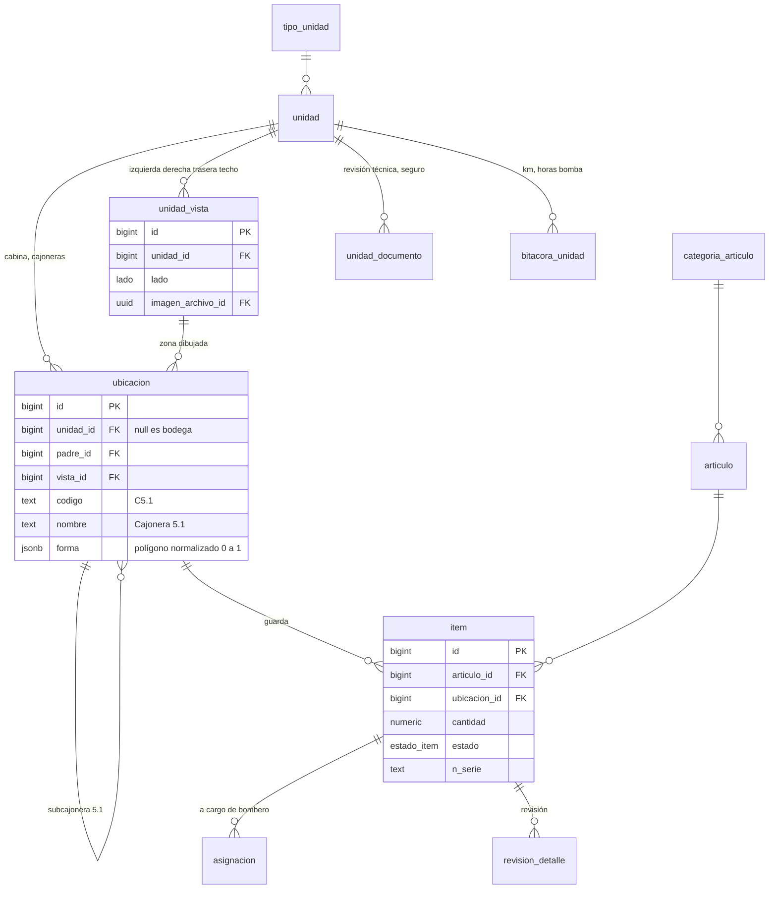

# ER · Material mayor y menor

## Cómo se dibuja la vista 2D
1. `unidad_vista` guarda la foto o SVG de un lado.
2. `ubicacion.forma` guarda un polígono `[[x,y], …]` normalizado 0–1.
3. Al tocar una zona, la app busca los `item` con esa `ubicacion_id` (o sus
   hijas) y muestra el contenido.
4. `revision_inventario` y `revision_detalle` registran la revisión en terreno.

## Reglas
- Una subcajonera (`C5.1`) cuelga de su padre (`C5`).
- `unidad_id` nulo representa la bodega del cuartel.
- Un artículo con `requiere_serie` exige cantidad 1.
- Los documentos de unidad vencen y generan alertas R09.

## Vistas
`material.v_inventario` y `material.v_plazos`.

## Relacionado con
`docs/modulos/material.md`, `app/src/features/material/`.
