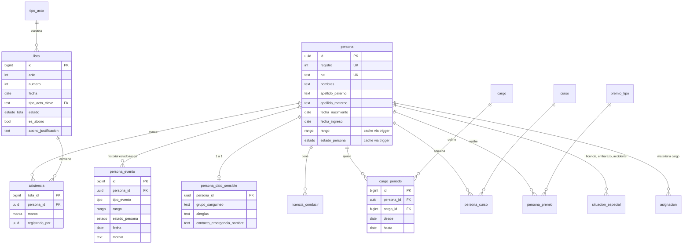

# ER · Personal y asistencia

## Reglas
- `persona.estado` y `persona.rango` son caché: solo cambian al insertar un
  `persona_evento`.
- El alta crea automáticamente un evento `alta`.
- `cargo_periodo` valida exclusividad y la incompatibilidad oficial ↔ consejo.
- Los datos sensibles no se leen directo: `personal.leer_dato_sensible()`.
- El porcentaje de asistencia excluye R y S del denominador.

## Vistas
| Vista | Uso |
|---|---|
| `personal.v_asistencia_persona` | A/F/P/% por año |
| `personal.v_hoja_vida` | JSON completo para el PDF P3 |
| `personal.v_plazos` | Licencias por vencer |
| `asistencia.lista` | Estado y cierre de listas |

## Relacionado con
`docs/datos/normalizacion.md`, `docs/modulos/personal.md`.
