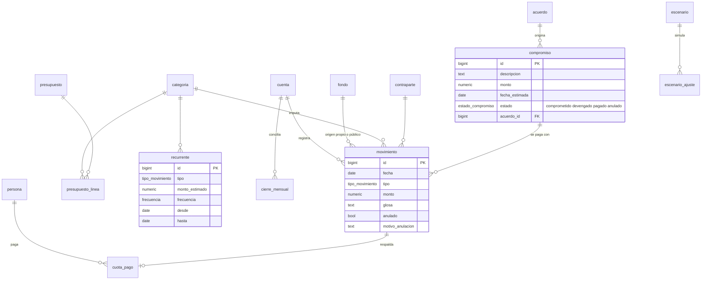
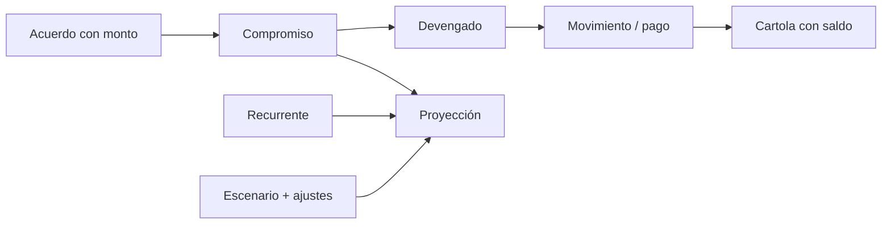

# ER · Tesorería

## Flujo

## Vistas y funciones
| Objeto | Devuelve |
|---|---|
| `tesoreria.v_cartola` | Movimientos con saldo corriente por cuenta |
| `tesoreria.v_presupuesto_ejecucion` | Ejecutado por categoría y año, con % |
| `tesoreria.v_compromisos_pendientes` | Monto menos pagado |
| `tesoreria.v_cuotas_pendientes` | Meses adeudados del año |
| `tesoreria.v_saldo_campana` | Saldo a favor para EPP |
| `tesoreria.fn_proyeccion(meses, escenario)` | Saldo mes a mes |

## Reglas
- `movimiento` no se borra: se anula con motivo.
- No se insertan movimientos en un período con `cierre_mensual`.
- El cierre guarda saldo de cartola y saldo libro; no recalcula ingresos.
- El fondo por defecto es "Fondos propios"; los públicos exigen rendición P14.

## Relacionado con
`docs/modulos/tesoreria.md`, `app/src/features/tesoreria/`.
