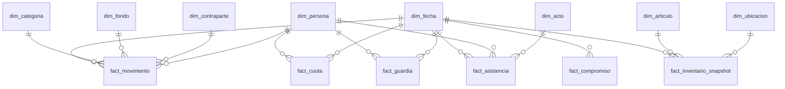

# Modelo dimensional (solo diseño)

## Propósito
Preparar la Etapa 6: un esquema `analitica` con un modelo estrella para
informes y tableros, sin cargarlo todavía en la base.

## Esquema estrella

## Dimensiones
| Dimensión | Origen | Nota |
|---|---|---|
| `dim_fecha` | Generada | Día, mes, año, trimestre, feriado, día de semana |
| `dim_persona` | `personal.persona` + `persona_evento` | **SCD tipo 2**: rango, estado y cargo con `valido_desde`/`valido_hasta` |
| `dim_cargo` | `personal.cargo` | Código y tipo |
| `dim_acto` | `asistencia.tipo_acto` | Clave y obligatoriedad |
| `dim_unidad` | `material.unidad` | Código y tipo |
| `dim_ubicacion` | `material.ubicacion` | Jerarquía unidad → cajonera → subcajonera |
| `dim_articulo` | `material.articulo` + categoría | Categoría y vida útil |
| `dim_categoria` | `tesoreria.categoria` | Ingreso/egreso |
| `dim_fondo` | `tesoreria.fondo` | Propio/público/donación |
| `dim_contraparte` | `nucleo.contraparte` | Proveedor, institución, donante |

## Hechos
| Hecho | Grano | Medidas |
|---|---|---|
| `fact_asistencia` | persona × lista | 1 por marca, marca como dimensión degenerada, `pct` se calcula |
| `fact_movimiento` | movimiento | monto, signo, anulado, tiene_comprobante |
| `fact_compromiso` | compromiso | monto, pagado, pendiente, días de atraso |
| `fact_inventario_snapshot` | ítem × fecha de revisión | cantidad, estado, valor |
| `fact_guardia` | persona × turno | cumplida, horas |
| `fact_cuota` | persona × período | monto, pagada, exenta |

## Estrategia de carga
1. Crear esquema `analitica` no expuesto.
2. Vistas materializadas por hecho, con índices en las FKs de dimensión.
3. Refresco nocturno con `pg_cron` después de `seguridad.generar_alertas()`.
4. `dim_persona` se reconstruye desde `persona_evento` para conservar historia.
5. Los informes leen solo `analitica`, nunca el OLTP.

## Informes que resuelve
| Punto | Informe | Hechos |
|---|---|---|
| P11 | Listas de asistencia y abono | `fact_asistencia` |
| P12 | Premios de constancia | `dim_persona` + `fact_asistencia` |
| P13 | Estado financiero mensual y deudas | `fact_movimiento`, `fact_cuota` |
| P18 | Inventarios de apertura | `fact_inventario_snapshot` |
| P21 | Balance anual de ingresos y gastos | `fact_movimiento` |

## Pendientes de diseño
- Definir si `dim_persona` incluye datos sensibles (no: se excluyen).
- Resolver el tratamiento de anulaciones y correcciones retroactivas.
- Definir retención de snapshots de inventario.
- Medir volumen antes de materializar.

## Relacionado con
`docs/hoja-de-ruta.md` (Etapa 6), `docs/datos/er-tesoreria.md`.
