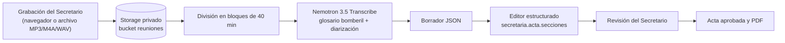

# Estudio · NVIDIA Nemotron 3.5 Transcribe para actas de reunión

Documento ejecutivo y técnico para presentar al Director de la Compañía. **La
integración en código queda en pausa** hasta que se apruebe el costo mensual.

---

## 1. Resumen ejecutivo

| Pregunta | Respuesta corta |
|---|---|
| ¿Se puede usar? | Sí, vía **API alojada** (NVIDIA NIM o un revendedor como OpenRouter o DeepInfra). |
| ¿Cuánto cuesta? | Del orden de **$120–$150 CLP por hora de reunión**. Con 4 a 10 horas al mes, **menos de $2.000 CLP al mes** incluyendo el modelo de redacción. |
| ¿Se puede auto-hospedar? | No es razonable: requiere una GPU con 68–75 GB de VRAM (H100 o A100). |
| ¿Es un gasto aprobable? | Sí: es un monto menor, pero implica enviar audio a un tercero, lo que exige consentimiento explícito. |
| ¿Qué falta? | Aprobar el presupuesto, redactar el aviso de grabación y un micrófono de conferencia. |

---

## 2. Veredicto de viabilidad

### Viable: API alojada
El modelo **Nemotron 3.5 Transcribe** se ofrece como servicio. El costo por minuto
está en el orden de **USD $0,002**, equivalente a **$120 a $150 CLP por hora**
según el tipo de cambio. La Compañía reúne entre 4 y 10 horas al mes entre
reuniones ordinarias, extraordinarias y asambleas.

### Inviable: auto-hospedado
Correr el modelo en un servidor propio exige una GPU de clase profesional
(A100/H100) con 68–75 GB de VRAM. Ese hardware cuesta del orden de USD $2.000 al
mes en la nube, más la operación. No se justifica para una compañía.

---

## 3. Comparativa de proveedores

Estimaciones mensuales para **4, 6 y 10 horas** de reuniones, incluyendo el
costo del LLM que redacta el borrador de acta a partir de la transcripción.

| Proveedor | Uso | Costo audio 4 h | 6 h | 10 h | LLM redacción | **Total estimado** |
|---|---|---|---|---|---|---|
| **NVIDIA NIM** (directo) | API oficial | $500–600 | $750–900 | $1.250–1.500 | +$200 | **$700–$1.700 CLP** |
| **OpenRouter** | Revende varios modelos | $550–650 | $800–950 | $1.350–1.600 | +$300 | **$850–$1.900 CLP** |
| **DeepInfra** | Revende modelos abiertos | $400–500 | $600–750 | $1.000–1.250 | +$150 | **$550–$1.400 CLP** |

Los rangos son aproximados y dependen del tipo de cambio, del largo de las
reuniones y de la tarifa del modelo que redacte el borrador. En cualquier caso,
**el monto mensual se mantiene bajo $2.000 CLP**.

El LLM de redacción puede ser un modelo económico (del orden de USD $0,15 a
$0,60 por millón de tokens), lo que no supera el costo del audio.

---

## 4. Arquitectura propuesta (cuando se apruebe)

### Por qué el editor ya está preparado
La migración `20261119000600_secretaria_completa.sql` agregó
`secretaria.acta.secciones` (JSON con `hora_inicio`, `preside`,
`correspondencia`, `cuenta_oficiales`, `incidentes`, `varios`). El borrador que
genere la transcripción se cargará **directamente en ese campo**, sin
refactorizar la base ni el editor. Los acuerdos detectados se propondrán como
líneas editables antes de guardarse.

### Flujo operativo
1. El Secretario abre la sesión en el editor y pulsa *Grabar*.
2. El audio se sube al bucket privado `reuniones`.
3. La Edge Function divide el audio en bloques de 40 minutos y llama a la API.
4. El resultado se transcribe con diarización (hasta 8 hablantes) usando un
   glosario de términos bomberiles (carro, ERA, charlie, cuartel, teniente).
5. El borrador llena las secciones y propone acuerdos.
6. El Secretario corrige, aprueba y emite el PDF como hoy.

### Glosario sugerido
Un glosario mejora mucho la precisión: *ERA* (equipo de respiración autónoma),
*charlie* (maquinista), *cuartel*, *guardia nocturna*, *Cuerpo*, *Comandancia*,
*teniente primero/segundo/tercero*, *cabo*, *voluntario*, *abono*, *cuota
social*, *campaña económica*.

---

## 5. Privacidad y Ley 21.719

| Riesgo | Medida |
|---|---|
| Audio con datos personales | Bucket privado, acceso solo Secretaría y Director |
| **Sesiones del Consejo de Disciplina** | **Bloqueo estricto**: no se permite grabar sesiones de tipo `CD`; el botón queda deshabilitado y se explica el motivo (art. 125 B 25) |
| Tercero procesa el audio | Se avisa verbalmente al inicio de cada sesión y se registra en el acta |
| Retención | El audio se borra automáticamente **30 días después de aprobada el acta** |
| Datos sensibles | No se envían a la API los datos de salud ni los expedientes disciplinarios |

El consentimiento de los asistentes debe quedar constancia en el acta: *"Se
informa que la sesión será transcrita con apoyo de inteligencia artificial para
elaborar el borrador del acta."*

---

## 6. Recomendación práctica de hardware

| Equipo | Costo aproximado | Por qué |
|---|---|---|
| Micrófono omnidireccional de conferencia USB | $30.000 – $50.000 CLP | Mejora enormemente la diarización frente a grabar con el celular sobre la mesa |
| Notebook del Secretario | ya disponible | Graba y sube el audio |

Con un celular a distancia, el sistema confunde hablantes y pierde palabras. El
micrófono de conferencia es la mejora más rentable por su bajo costo.

---

## 7. Plan de activación (si se aprueba)

| Paso | Acción | Responsable |
|---|---|---|
| 1 | Aprobar el presupuesto mensual (máx. $2.000 CLP) | Director |
| 2 | Crear la cuenta en el proveedor y cargar la clave en Supabase | Admin |
| 3 | Comprar el micrófono de conferencia | Tesorero |
| 4 | Redactar y aprobar el aviso de grabación | Secretaría y Directorio |
| 5 | Construir la Edge Function de transcripción y conectar el editor | Desarrollo |
| 6 | Prueba en una reunión ordinaria y ajuste del glosario | Secretaría |

---

## 8. Qué no incluye este estudio

- No se agregaron tablas ni botones inactivos en la aplicación.
- No se envió ningún audio a ningún proveedor.
- No se configuraron credenciales ni se crearon cuentas.

Este documento queda como base de decisión. Si el Director aprueba el costo, la
integración se construye sobre el editor de actas ya terminado.

---

## Relacionado con
`docs/modulos/secretaria.md`, `supabase/migrations/20261119000600_secretaria_completa.sql`,
`docs/hoja-de-ruta.md`.
