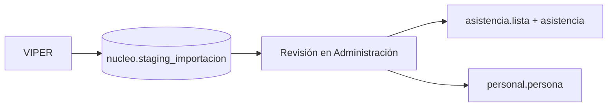

# VIPER Gestión (integración futura)

## Estado
Documentado, sin integración activa. Requiere que el Cuerpo de Bomberos
proporcione una API o un mecanismo de exportación estable.

## Qué se necesita
1. Endpoint o archivo de asistencia por acto (fecha, clave, personal, marca).
2. Identificador estable de bombero (registro de compañía o RUT).
3. Credenciales y cuota de uso.
4. Ventana de sincronización (diaria o semanal).

## Diseño propuesto

- Cada descarga crea filas en staging con `origen = 'viper_asistencia'`.
- La revisión muestra diferencias contra las listas existentes.
- Al aprobar, se hace upsert idempotente por `(lista_id, persona_id)`.
- Los conflictos se resuelven a mano; no se sobrescribe una lista enviada sin
  motivo.

## Mientras no haya API
Usa la importación CSV descrita en `importacion.md`. No se digita dos veces.

## Riesgos
- Nombres o registros que no coinciden con la compañía → staging.
- Series y claves de acto distintas → tabla de equivalencias.
- Duplicación de listas → `ref_externa` y validación de fecha/número.

## Relacionado con
`docs/integraciones/importacion.md`, `asistencia.lista.ref_externa`.
