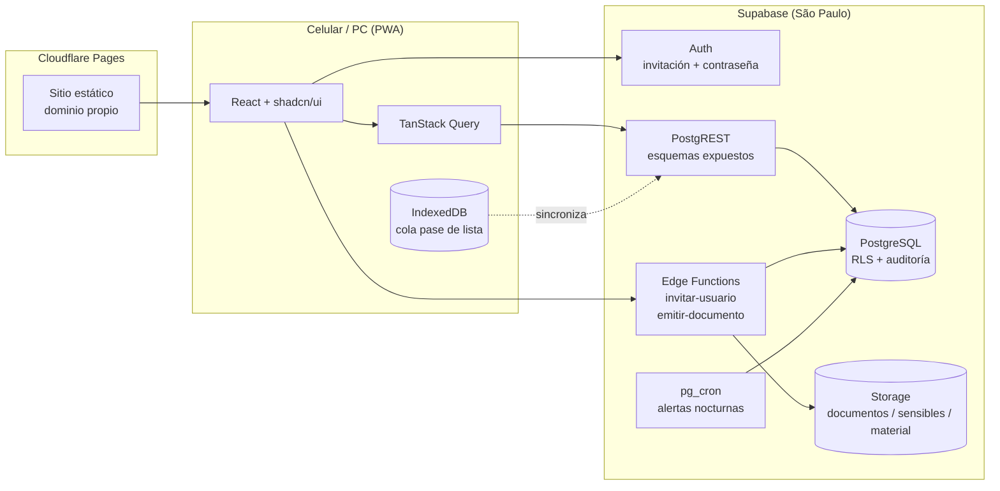
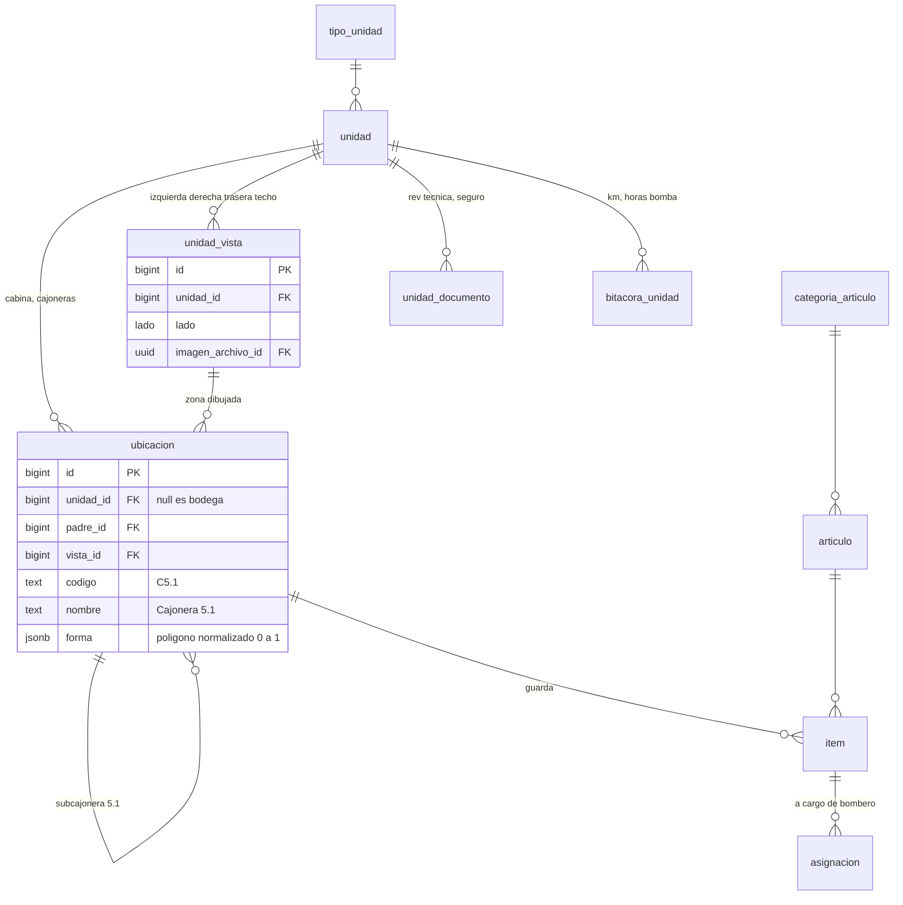
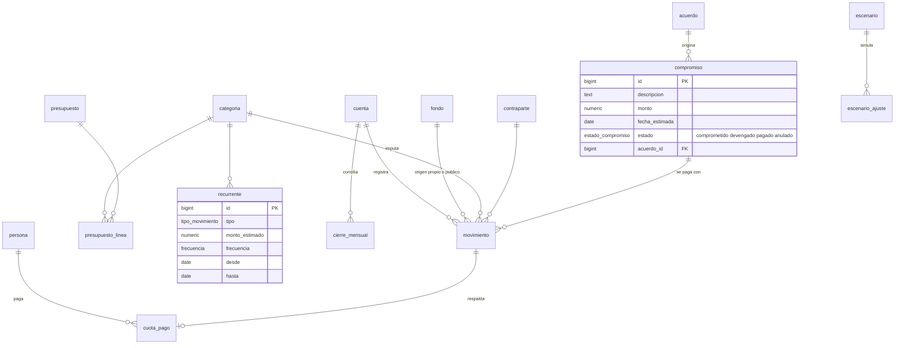
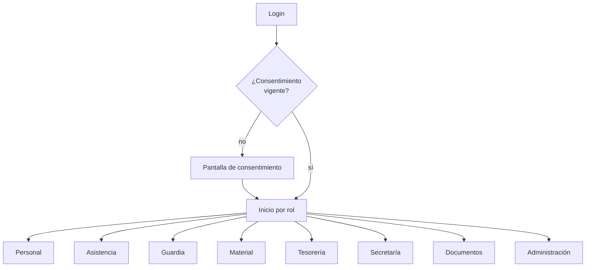
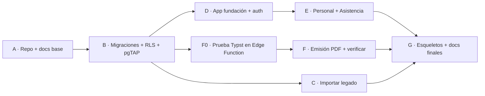

# Plan de implementación · ERP Segunda Compañía CBL

## Objetivo

La base que entregó el director (`plataforma_2da/`) tiene **35 tablas SQL en un solo esquema, un script de migración, una plantilla Typst y ningún frontend**. Además, nunca se ejecutó en un servidor. El plan es convertirla en un **sistema sólido, normalizado, documentado y usable desde el celular**, siguiendo los 8 módulos y los 23 puntos de impresión del documento *ERP Segunda Compañía CBL*. También deja preparadas las dos líneas de la próxima etapa: el **inventario gráfico de carros** y la **tesorería tipo cartola con proyecciones**.

### Decisiones acordadas

| Tema | Decisión |
|---|---|
| Alcance | Una instancia por compañía. Si otra compañía quiere usarlo, despliega su propia copia y configura `nucleo.compania` |
| Frontend | React + Vite + TypeScript (SPA estática), shadcn/ui, TanStack Router/Query, PWA, en Cloudflare Pages |
| Base de datos | Migraciones reescritas desde cero, **un esquema por dominio**. Las 4 originales se archivan en `docs/legado/` |
| Permisos | Roles **manuales**, separados del historial de cargos. `teniente` se divide en `teniente_1`, `teniente_2` y `teniente_3`. Los asignan el Director y el admin |
| Login | Correo + contraseña, solo por invitación (sin registro abierto) |
| Datos sensibles | Tabla separada, visible para la oficialidad, con **consentimiento obligatorio** en el primer ingreso (Ley 21.719) |
| Datos reales | Nunca en git. El `seed.sql` actual se convierte al esquema nuevo y queda en `data/privado/` |
| Tesorería | Una cuenta (como hoy, pero preparada para más), con flujo Comprometido → Devengado → Pagado, gastos e ingresos fijos, proyecciones y simulaciones |
| Material mayor | Vista **2D** por lado del carro (foto o SVG) con cajoneras tocables. Coordenadas guardadas en la base |
| Navegación | Por función y filtrada por rol. Barra inferior en el celular, barra lateral en el computador. Inicio distinto según el cargo |
| Visual | Rojo institucional, neutros cálidos, escudo, modo claro/oscuro, botones de 44 px o más |
| Sin conexión | Solo el pase de lista, con cola de sincronización |
| PDF | Hoja de vida (P3) completa: Edge Function con Typst, folio, SHA-256, Storage y página `/verificar/:token` |
| VIPER | Se documenta como integración futura (requiere pedir una API). Por ahora se usa un staging genérico CSV/Excel |
| Dimensional | Solo diseño y documentación (no se crea en la base todavía) |
| Entorno | Local con Supabase CLI + Docker y pruebas RLS con pgTAP. Guía paso a paso para la nube |
| Construido en esta etapa | Fundación completa + **Personal/Hoja de vida + Asistencia** funcionales. Los demás módulos quedan como esqueleto con ruta y README |

---

## Requiere tu revisión

> [!IMPORTANT]
> **Se agrega el esquema `disciplina`**, que no estaba en la lista acordada. Los expedientes del Consejo deben quedar aislados (art. 125 B 25) con su propio esquema y permisos, separados de `personal`. Solo los ve el rol `consejo`, y el Director ve solo las sanciones ya ejecutoriadas.

> [!IMPORTANT]
> **Se agrega el concepto de *fondo* a los movimientos** aunque hoy exista una sola cuenta. Por defecto todo queda como "Fondos propios", así que el Tesorero no tiene que hacer nada distinto. Cuando llegue un aporte fiscal o municipal, basta con marcarlo, y la rendición (P14, Res. 30/2015 CGR) sale sola. Agregarlo después costaría una migración de datos.

> [!WARNING]
> **Riesgo técnico en la emisión de PDF:** compilar Typst en WASM dentro de una Edge Function de Supabase puede chocar con el límite de CPU por petición (unos 2 s) y de tamaño del bundle, porque las fuentes pesan. **Plan B, ya diseñado:** compilar en el navegador con `typst.ts` y enviar el PDF a la Edge Function. La función calcula el SHA-256 en el servidor, asigna el folio, lo guarda y lo registra. Se pierde algo de garantía, porque el contenido lo arma el cliente, pero el emisor es un oficial autenticado y queda auditado. Lo confirmo con una prueba al inicio de la fase F.

> [!WARNING]
> **Supabase CLI exige que `supabase/migrations/` sea una carpeta plana.** No se pueden usar subcarpetas por dominio. Uso nombres con prefijo de dominio (`…_0400_personal.sql`) y un README que los mapea.

> [!CAUTION]
> El texto de **consentimiento de datos personales** que redactaré es un borrador. Debe revisarlo alguien con criterio legal o el Directorio antes de invitar a bomberos reales. Queda versionado, y si cambia el texto, el sistema vuelve a pedir el consentimiento.

---

## Preguntas abiertas (no bloquean; uso el valor por defecto si no respondes)

1. **Antigüedad mínima por cargo (R10)**: el original usa 2 años como parámetro. Lo dejo configurable en `nucleo.parametro` con ese valor.
2. **Art. 181 d vs art. 49 (Miembro Honorario)**: uso el art. 49 (35 años), como dice el ERP, y lo dejo como parámetro.
3. **Valor de la cuota mensual**: no aparece en los datos. Creo `tesoreria.cuota_valor` vacía para que el Tesorero la configure.
4. **Tipos de acto**: 34 claves vienen sin descripción ("Clave 15-2 (completar descripción)"). Quedan marcadas para completar desde la pantalla de catálogos.

---

## Arquitectura



---

## Estructura del repositorio (monorepo)

```
ProyectoBomba/
├── README.md                     ← qué es, cómo empezar en 5 min, mapa del repo
├── .gitignore  .editorconfig  .nvmrc
├── package.json  pnpm-workspace.yaml
├── .github/workflows/
│   ├── ci.yml                    ← lint, typecheck, tests, build, supabase db lint/test
│   └── deploy.yml                ← publica app/ en Cloudflare Pages (manual al inicio)
├── app/                          ← frontend (README)
│   └── src/
│       ├── app/                  ← router, providers, AppShell (README)
│       ├── components/
│       │   ├── ui/               ← shadcn generados
│       │   ├── layout/           ← Sidebar, BottomNav, PageHeader, MoreSheet
│       │   └── common/           ← StatusBadge, EmptyState, ResponsiveList, ConfirmDialog…
│       ├── features/             ← un módulo = una carpeta = un esquema (README c/u)
│       │   ├── auth/  inicio/  personal/  asistencia/  guardia/
│       │   ├── material/  tesoreria/  secretaria/  documentos/
│       │   └── administracion/  verificar/
│       ├── lib/                  ← supabase.ts, permisos.ts, formato.ts (CLP, es-CL), offline/
│       └── types/database.ts     ← generado con `supabase gen types`
├── supabase/                     ← (README)
│   ├── config.toml
│   ├── migrations/               ← planas, numeradas por dominio (README)
│   ├── functions/                ← invitar-usuario, emitir-documento, _shared (README)
│   ├── tests/                    ← pgTAP: RLS, reglas, integridad (README)
│   └── seed.sql                  ← datos FICTICIOS de desarrollo
├── plantillas/                   ← Typst + escudo (README)
├── scripts/                      ← (README)
│   ├── importar-legado/          ← convierte el seed antiguo al esquema nuevo
│   └── generar-seed-ficticio/
├── data/                         ← (README) privado/ ignorado por git
└── docs/                         ← (README índice)
    ├── arquitectura/             ← visión, stack, seguridad, ADRs (decisiones)
    ├── datos/                    ← ER por dominio, diccionario, normalización, dimensional
    ├── modulos/                  ← 1 archivo por módulo: alcance, artículos, P-docs, estado
    ├── ux/                       ← guía de diseño, patrones, componentes, accesibilidad
    ├── operacion/                ← instalación local, Supabase nube, Cloudflare, dominio, respaldos
    ├── integraciones/            ← VIPER (futuro), importación CSV/Excel
    ├── hoja-de-ruta.md           ← etapas 2…6
    └── legado/                   ← PDF originales, SQL 0001–0004, script y README antiguos
```

Cada carpeta lleva un `README.md` con el mismo formato: **Propósito · Contenido · Cómo se usa · Convenciones · Relacionado con**.

---

## Base de datos normalizada

### Problemas detectados en el esquema original

| # | Problema | Corrección |
|---|---|---|
| 1 | Texto libre donde debería haber catálogo: `cargo_periodo.cargo`, `premio.tipo`, `unidad.tipo`, `articulo.categoria`, `acta.tipo`, `movimiento.medio_pago` | Tablas catálogo con FK (`cargo`, `premio_tipo`, `tipo_unidad`, `categoria_articulo`, `tipo_sesion`) o enums |
| 2 | `item_inventario.ubicacion = 'Cajonera 5.1'` como texto | `material.ubicacion` jerárquica (unidad → cajonera → subcajonera), con forma/coordenadas para la vista 2D |
| 3 | `movimiento.categoria_id` **y** `presupuesto_linea_id` pueden contradecirse. Además, el seed no vincula líneas con categorías, así que la vista de ejecución siempre da 0 | La línea de presupuesto se define por `(presupuesto, categoria)`. La ejecución se calcula por categoría y año, y se elimina el doble vínculo |
| 4 | `presupuesto_linea.tipo` repite `categoria.tipo` | Se elimina (se deriva) |
| 5 | `contraparte` como texto en movimientos y correspondencia | `nucleo.contraparte` compartida (proveedores, instituciones, donantes) |
| 6 | No hay fondo ni cuenta en tesorería, ni compromisos ni recurrentes | `cuenta`, `fondo`, `compromiso`, `recurrente`, `escenario` |
| 7 | `adjunto` polimórfico (`entidad`, `entidad_id` texto) y `*_path` repetidos en 8 tablas | `documentos.archivo` con FK real desde cada tabla |
| 8 | Datos sensibles (grupo sanguíneo) en `persona` | `personal.persona_dato_sensible` 1:1 |
| 9 | `persona.estado` y `rango` sin historial | `personal.persona_evento` (alta, cambio de rango, suspensión, renuncia…) como fuente de verdad. Un trigger mantiene el estado actual |
| 10 | `guardia` es una fila por persona, sin turno ni jefe de guardia | `operaciones.guardia_turno` + `guardia_integrante` |
| 11 | `revision_tecnica_vence` y `seguro_vence` como columnas fijas | `material.unidad_documento` (tipo, vence, archivo) |
| 12 | `acta.presentes` y `permisos` duplican la lista asociada | Se derivan de la lista |
| 13 | `cierre_mensual` guarda ingresos y egresos calculados, que pueden quedar desfasados | Se calculan en una vista. El cierre bloquea por trigger nuevos movimientos en ese período y guarda solo el saldo de cartola bancaria y una instantánea del saldo libro para control |
| 14 | `acuerdo_movimiento` sin el concepto de compromiso | `acuerdo` → `compromiso` → `movimiento` |
| 15 | El rol `consejo` lee todo por `es_oficial()` | El consejo lee solo `disciplina` y lo mínimo de `personal` |
| 16 | `grant execute on all functions` deja que cualquiera ejecute `generar_alertas()` | Funciones internas en `seguridad` (no expuesto) y RPC explícitas |
| 17 | La auditoría no guarda la IP (requisito ERP §9) | Se lee de `request.headers` (`x-forwarded-for`) |
| 18 | Sin postulación, situaciones especiales, bitácora de unidades, licencias de conducir, accidentes, elecciones, traspaso | Tablas creadas (esqueleto funcional en la base) |
| 19 | Errores del seed: series `'181453.0'`, nombres mal partidos con 4 o más palabras, `REO` vs `RE` inconsistente, cuotas sin bombero | Se corrigen en `importar-legado` y lo dudoso pasa a `staging_importacion` |

### Esquemas y tablas

| Esquema | Expuesto API | Tablas principales |
|---|---|---|
| `nucleo` | ✅ | `compania` (fila única de configuración), `parametro`, `feriado`, `contraparte`, `alerta`, `regla_alerta`, `staging_importacion` |
| `seguridad` | ❌ (solo RPC) | `usuario`, `usuario_rol`, `consentimiento_texto`, `consentimiento`, `auditoria` |
| `personal` | ✅ | `persona`, `persona_evento`, `persona_dato_sensible`, `licencia_conducir`, `antiguedad_abono`, `cargo`, `cargo_periodo`, `curso`, `persona_curso`, `premio_tipo`, `persona_premio`, `situacion_especial`, `postulacion` |
| `asistencia` | ✅ | `tipo_acto`, `lista`, `asistencia` |
| `operaciones` | ✅ | `orden_capitania`, `guardia_turno`, `guardia_integrante`, `accidente_servicio` |
| `material` | ✅ | `tipo_unidad`, `unidad`, `unidad_documento`, `unidad_vista`, `ubicacion`, `categoria_articulo`, `articulo`, `item`, `asignacion`, `mantencion`, `revision_inventario`, `revision_detalle`, `bitacora_unidad` |
| `tesoreria` | ✅ | `cuenta`, `fondo`, `categoria`, `presupuesto`, `presupuesto_linea`, `movimiento`, `compromiso`, `recurrente`, `escenario`, `escenario_ajuste`, `cuota_valor`, `cuota_pago`, `cierre_mensual`, `campana`, `talonario`, `campana_participacion`, `beneficio`, `donacion` |
| `secretaria` | ✅ | `tipo_sesion`, `acta`, `acuerdo`, `correspondencia`, `eleccion`, `candidatura`, `traspaso_cargo` |
| `disciplina` | ✅ (solo consejo) | `expediente`, `sancion`, `medida_preventiva`, `plazo_disciplinario` |
| `documentos` | ✅ | `archivo`, `tipo_documento` (P1–P23), `documento_emitido`, `folio_contador` |

### ER · Personal y asistencia

```mermaid
erDiagram
  persona ||--o{ persona_evento : "historial estado/rango"
  persona ||--o| persona_dato_sensible : "1 a 1"
  persona ||--o{ licencia_conducir : tiene
  persona ||--o{ cargo_periodo : ejerce
  cargo ||--o{ cargo_periodo : define
  persona ||--o{ persona_curso : aprueba
  curso ||--o{ persona_curso : ""
  persona ||--o{ persona_premio : recibe
  premio_tipo ||--o{ persona_premio : ""
  persona ||--o{ situacion_especial : "licencia, embarazo, accidente"
  persona ||--o{ asistencia : marca
  lista ||--o{ asistencia : contiene
  tipo_acto ||--o{ lista : clasifica
  persona {
    uuid id PK
    int registro UK
    text rut UK
    text nombres
    text apellido_paterno
    text apellido_materno
    date fecha_nacimiento
    sexo sexo
    date fecha_ingreso
    rango rango "cache via trigger"
    estado estado "cache via trigger"
  }
  lista {
    bigint id PK
    int anio
    int numero
    date fecha
    text tipo_acto FK
    estado_lista estado "borrador cerrada enviada"
    bool es_abono
    text abono_justificacion
  }
  asistencia {
    bigint lista_id PK
    uuid persona_id PK
    marca marca "A F P R S L"
    uuid registrado_por
  }
```



### ER · Material mayor (base de la vista 2D)



### ER · Tesorería (cartola, compromisos, proyecciones)



**Vistas de tesorería** (previstas para la Etapa 2, pero el esquema ya queda creado):
- `v_cartola`: movimientos con saldo corriente (`sum() over (order by fecha, id)`) por cuenta.
- `v_compromisos_pendientes`: monto comprometido menos lo pagado.
- `fn_proyeccion(meses, escenario_id)`: saldo actual + recurrentes + compromisos ± ajustes del escenario, mes a mes.
- `v_presupuesto_ejecucion`: por categoría y año.

### Reglas de integridad nuevas (en la base, no en la app)
- `asistencia.lista` cerrada y enviada no se edita sin `motivo` (trigger + auditoría).
- `cargo_periodo`: restricción de exclusión `btree_gist` que impide dos titulares del mismo cargo único en fechas superpuestas, y trigger de incompatibilidad Oficial ↔ Consejo (art. 44).
- `movimiento`: no se borra (se anula con motivo). No se inserta en un período cerrado.
- `item`: si el artículo exige número de serie, la cantidad debe ser 1.
- `persona_evento` mantiene `persona.estado` y `rango` (un solo camino de escritura).
- `documento_emitido`: folio correlativo sin saltos por tipo y año (se mantiene el diseño original).

### Seguridad (RLS) · matriz resumida

| Esquema | bombero | oficialidad (lectura) | Escriben |
|---|---|---|---|
| personal | lo propio | todo | secretario, prosecretario, director |
| personal.dato_sensible | lo propio | todos los oficiales (cada lectura queda auditada) | secretario, director, el propio bombero |
| asistencia | listas + lo propio | todo | ayudante, capitán, secretario |
| operaciones | sus guardias | todo | capitán, ayudante, teniente_1 |
| material (unidades, ítems) | — | todo | capitán, teniente_3 |
| material.asignacion | lo propio | todo | capitán, teniente_2 |
| tesorería | sus cuotas y su campaña | todo | tesorero, protesorero (presupuesto: + director) |
| secretaría | actas aprobadas | todo | secretario, prosecretario |
| disciplina | — | **solo consejo** (director: sanciones ejecutoriadas) | consejo |
| documentos | los suyos | todo | emite cualquier oficial vía Edge Function |
| seguridad | sus roles y su consentimiento (RPC) | — | director, admin (RPC) |

Las pruebas pgTAP verifican **cada celda** con usuarios simulados (`set local role authenticated` + `request.jwt.claims`).

### Modelo dimensional (solo documentado)
`docs/datos/modelo-dimensional.md` con un modelo estrella:
- **Dimensiones**: `dim_fecha`, `dim_persona` (SCD tipo 2, alimentada desde `persona_evento`), `dim_cargo`, `dim_acto`, `dim_unidad`, `dim_ubicacion`, `dim_articulo`, `dim_categoria`, `dim_fondo`, `dim_contraparte`.
- **Hechos**: `fact_asistencia` (grano persona × lista), `fact_movimiento` (grano movimiento), `fact_compromiso`, `fact_inventario_snapshot` (grano ítem × fecha de revisión), `fact_guardia`, `fact_cuota`.
- Mapeo de cada columna OLTP → DW, estrategia de carga (vistas materializadas en un esquema `analitica` + pg_cron) y los informes P11, P12, P13, P18, P21 que resuelve.

---

## Frontend: UX/UI

### Navegación



- **Celular**: barra inferior con 4 accesos según el rol (p. ej. Ayudante: *Inicio · Asistencia · Personal · Más*; Tesorero: *Inicio · Tesorería · Personal · Más*). El resto queda en una hoja inferior "Más".
- **Computador/tablet** (≥ 1024 px): barra lateral colapsable con secciones y buscador global (`Ctrl K`).
- **Inicio por rol**: (1) tarjeta de **tareas pendientes** con plazo, p. ej. "Lista N° 132 vence en 20 h (art. 188)"; (2) **alertas** de las reglas R01–R11; (3) **accesos rápidos**: *Pasar lista*, *Mi hoja de vida*, *Registrar movimiento*.
- El bombero sin cargo ve una versión mínima: su hoja de vida, asistencia, material a cargo, cuotas y documentos.

### Patrones de diseño aplicados
| Patrón | Dónde |
|---|---|
| Lista → detalle con URL propia | Personal, listas, unidades, movimientos |
| Lista adaptable: **tarjetas en el celular, tabla en el escritorio** (`ResponsiveList`) | Todas las colecciones |
| Filtros en hoja inferior (celular) o barra (escritorio), con chips de filtros activos | Personal, asistencia, tesorería |
| Formularios de una columna, por secciones, con barra de guardar fija abajo en el celular, validación en línea (zod) y borrador automático | Altas y ediciones |
| Pestañas en el detalle | Hoja de vida: *Resumen · Asistencia · Cargos · Formación · Premios · Material · Documentos* |
| Estados vacíos con acción, *skeletons* al cargar, toasts con "deshacer" cuando aplica | Global |
| Semáforo semántico fijo: 🟢 al día · 🟡 por vencer · 🔴 vencido · ⚪ sin dato | Plazos, documentos de unidades, cuotas |
| Confirmación explícita con motivo para acciones irreversibles | Anular movimiento, reabrir lista |
| Indicador de conexión y de "pendientes por sincronizar" | Barra superior |

### Pantalla clave · Pase de lista (sin conexión)
- Encabezado fijo: acto, fecha, contador en vivo `A 18 · F 4 · P 2 · sin marcar 12`.
- Una fila por bombero, ordenada por registro, con buscador. **Botones grandes A / F / P** visibles y un menú "⋯" para R, S y L. Las situaciones especiales vigentes (licencia, embarazo, suspensión) **se premarcan** y se explica por qué.
- Acción "Marcar resto como Falta" y botón **Cerrar lista**, que muestra el resumen y el plazo de 48 h.
- Se guarda en IndexedDB y sincroniza con *upsert* idempotente (`lista_id, persona_id`). Si otro dispositivo editó la misma fila, se avisa del conflicto.

### Sistema de diseño
- Tokens CSS (`--color-primario: #9B1C1C`, neutros cálidos, `--radius`, escalas) en `app/src/app/tema.css`, compatibles con shadcn y con modo oscuro por `prefers-color-scheme` y selector manual.
- Tipografía del sistema (rápida y legible), tamaño base de 16 px, objetivos táctiles ≥ 44 px, contraste WCAG AA, foco visible, `lang="es-CL"`, montos en CLP sin decimales y fechas `dd-mm-aaaa`.
- Antes de escribir CSS/HTML consultaré la skill **modern-web-guidance** para usar APIs actuales (dialog/popover, container queries, view transitions).
- `docs/ux/guia-de-diseno.md` con capturas de cada componente.

---

## Cambios propuestos por componente

### A · Repositorio y documentación base
#### [NEW] `.gitignore`, `.editorconfig`, `.nvmrc`, `package.json`, `pnpm-workspace.yaml`, `README.md`
- `.gitignore` estricto: `data/privado/`, `*.env*` (salvo `.env.example`), `supabase/.temp`, `node_modules`, `dist`, `*.pdf` emitidos.
- `git init` y primer commit **sin** datos reales.
#### [NEW] `docs/**` (índice, arquitectura, ADRs, módulos, operación, hoja de ruta, integraciones/VIPER)
#### [MOVE] `plataforma_2da/**` y los PDF → `docs/legado/` (originales intactos) · `plantillas/` (Typst + escudo)
- `supabase/seed.sql` (real) → `data/privado/legado/seed_original.sql`

---

### B · Supabase: migraciones
#### [NEW] `supabase/config.toml` (esquemas expuestos, auth sin registro abierto, URL de redirección)
#### [NEW] `supabase/migrations/`
```
20261112000000_extensiones_esquemas.sql     pgcrypto, unaccent, btree_gist, pg_cron; crea esquemas
20261112000100_seguridad.sql                enum rol, usuario, usuario_rol, helpers tiene_rol/es_oficial/mi_persona,
                                            auditoría con IP, consentimiento
20261112000200_nucleo.sql                   compania, parametro, feriado, contraparte, alerta, staging
20261112000300_documentos_archivo.sql       archivo, tipo_documento (P1–P23 precargados)
20261112000400_personal.sql                 + RLS
20261112000500_asistencia.sql               + RLS + trigger de lista cerrada
20261112000600_operaciones.sql              + RLS
20261112000700_material.sql                 + RLS
20261112000800_tesoreria.sql                + RLS + no borrar + período cerrado
20261112000900_secretaria.sql               + RLS + FK diferidas (acta_id en cargo, premio, presupuesto…)
20261112001000_disciplina.sql               + RLS reservada
20261112001100_documentos_emision.sql       documento_emitido, folio, verificar_documento (anon)
20261112001200_auditoria_triggers.sql       trigger en todas las tablas de negocio
20261112001300_vistas_cruces.sql            v_asistencia_persona, v_hoja_vida, v_plazos, alertas R01–R11 (+R12 lista 48 h)
20261112001400_api_rpc.sql                  mis_roles(), mi_perfil(), aceptar_consentimiento(), admin_* para roles
20261112001500_storage.sql                  buckets documentos, sensibles, material (privados) + políticas
20261112001600_cron.sql                     generar_alertas() cada noche
```
Ejemplo del estilo (`material.ubicacion`):
```sql
create table material.ubicacion (
  id         bigint generated always as identity primary key,
  unidad_id  bigint references material.unidad(id),          -- null = bodega del cuartel
  padre_id   bigint references material.ubicacion(id),
  vista_id   bigint references material.unidad_vista(id),
  tipo       material.tipo_ubicacion not null,               -- bodega | cabina | cajonera | techo | otro
  codigo     text not null,                                  -- 'C5.1'
  nombre     text not null,                                  -- 'Cajonera 5.1'
  forma      jsonb,                                          -- [[x,y],…] normalizado 0–1 sobre la imagen
  orden      smallint not null default 0,
  unique (unidad_id, codigo),
  check (forma is null or jsonb_typeof(forma) = 'array')
);
comment on table material.ubicacion is 'Lugares físicos donde se guarda material: bodega, cabina, cajoneras y subcajoneras de cada unidad.';
```
Todas las tablas y columnas no obvias llevan `comment on`, para que el diccionario de datos se genere solo.

#### [NEW] `supabase/functions/invitar-usuario/` · `emitir-documento/` · `_shared/`
- `invitar-usuario`: verifica que quien llama sea `director` o `admin` → `auth.admin.inviteUserByEmail` → vincula `seguridad.usuario` con la persona y le asigna roles.
- `emitir-documento`: arma el JSON desde `personal.v_hoja_vida` → `siguiente_folio` → QR → compila Typst → SHA-256 → Storage → `documento_emitido`. Devuelve una URL firmada.

#### [NEW] `supabase/tests/*.test.sql` (pgTAP)
`rls_personal`, `rls_sensible`, `rls_tesoreria`, `rls_disciplina`, `asistencia_reglas`, `tesoreria_reglas`, `folio_correlativo`, `consentimiento`, `alertas`.

#### [NEW] `supabase/seed.sql` (ficticio)
30 bomberos inventados, cargos 2026, 40 listas, 3 unidades con vistas y cajoneras de ejemplo, 6 meses de movimientos, compromisos y recurrentes, y usuarios de prueba por rol (`director@demo.local`, `ayudante@demo.local`…).

---

### C · Importación del legado
#### [NEW] `scripts/importar-legado/` (`importar.sh`, `00_cargar_legado.sql`, `10_transformar.sql`, `README.md`)
1. En la base local crea el esquema temporal `legado`, ejecuta `0001_esquema.sql` original (con `gestion` → `legado`) y `seed_original.sql`.
2. `10_transformar.sql` traspasa al esquema nuevo con estas correcciones: `.0` en las series, nombres compuestos, `Cajonera N[.M]` → `ubicacion` jerárquica, `guardia` → turnos, `REO`/`RE` unificados, categorías vinculadas al presupuesto, actas → `tipo_sesion`, correspondencia → `contraparte`.
3. Emite un **informe de conciliación** (filas origen vs destino por tabla) y deja lo dudoso en `nucleo.staging_importacion`.
4. Exporta `data/privado/seed_real.sql` (`pg_dump --data-only`) y elimina `legado`.
- El inventario queda listo para **reemplazarse** con la actualización que viene, usando el mismo staging (plantilla CSV documentada en `docs/integraciones/importacion.md`).

---

### D · Frontend: fundación
#### [NEW] `app/` (Vite + React 19 + TS estricto + Tailwind v4 + shadcn/ui + TanStack Router/Query + react-hook-form + zod + vite-plugin-pwa + Dexie)
- `lib/supabase.ts`: cliente tipado, uno por esquema (`db.personal`, `db.asistencia`…).
- `lib/permisos.ts`: mapa **rol → secciones/acciones** (única fuente para el menú y los guards; la seguridad real la pone RLS).
- `app/AppShell`: Sidebar / BottomNav / MoreSheet, `PageHeader`, indicador de conexión, `ThemeToggle`.
- `features/auth`: login, recuperar contraseña, establecer contraseña desde la invitación, consentimiento.
- `features/administracion`: usuarios y roles (invitar, asignar o revocar con fechas), catálogos (tipos de acto, cargos), parámetros.
- `features/verificar`: página pública `/verificar/:token`.

### E · Frontend: Etapa 1 funcional
- **`features/inicio`**: dashboard por rol (tareas, alertas, accesos rápidos).
- **`features/personal`**: lista con búsqueda y filtros (estado, rango, cargo) · ficha/hoja de vida con pestañas · alta y edición · eventos de estado · cargos · cursos · premios · datos sensibles (sección aparte, con aviso de confidencialidad) · licencia de conducir.
- **`features/asistencia`**: listas del año · crear lista · **pase de lista sin conexión** · cerrar/enviar con plazo · abonos con justificación obligatoria · resumen por bombero (% anual, gráfico mensual) · "Mi asistencia" para el bombero.
- **`features/documentos`**: emitir hoja de vida, historial de documentos emitidos y anulación con motivo.

### F · Esqueletos (ruta + pantalla "Próximamente" con alcance + README)
`guardia`, `material` (incluye un mock estático de la vista 2D con una foto/SVG de ejemplo para validar la idea), `tesoreria` (mock de cartola + gráfico de proyección con datos ficticios), `secretaria`.

---

## Orden de ejecución



## Hoja de ruta posterior (queda en `docs/hoja-de-ruta.md`)
| Etapa | Contenido |
|---|---|
| 2 | **Tesorería cartola**: registro, conciliación mensual, compromisos, recurrentes, escenarios, gráficos (saldo proyectado 3/6/12 meses, ejecución presupuestaria, ingresos vs egresos), P13 y P21 |
| 3 | **Material mayor 2D** (editor de zonas sobre foto, inventario por cajonera, revisión en terreno), vestuario y EPP (P8, P9), guardia nocturna (P7), bitácoras (P10) |
| 4 | Premios de constancia (quinquenios con arrastre, P12) |
| 5 | Electoral (P15), disciplina (P16), traspaso anual (P17), memoria y carpeta anual |
| 6 | Base dimensional `analitica` + módulo de informes · integración API VIPER |
| Transversal | Compra del dominio + Cloudflare Pages + proyecto Supabase en la nube (guía en `docs/operacion/`) |

---

## Plan de verificación

### Pruebas automáticas
```bash
pnpm install
pnpm supabase start                      # Supabase local (Docker)
pnpm supabase db reset                   # aplica las 17 migraciones + seed ficticio sin errores
pnpm supabase db lint                    # linter de Postgres/Supabase (seguridad y rendimiento)
pnpm supabase test db                    # pgTAP: matriz RLS completa + reglas de negocio
pnpm -C app typecheck && pnpm -C app lint
pnpm -C app test                         # Vitest: permisos, formato, cola offline, componentes
pnpm -C app build                        # build estático para Cloudflare Pages
pnpm -C app e2e                          # Playwright en 390×844 (iPhone) y 1440×900
bash scripts/importar-legado/importar.sh # informe de conciliación: 56 personas, 135 listas, 246 movimientos…
```
Casos e2e: login → consentimiento → inicio por rol · el bombero no ve Tesorería ni datos ajenos · pase de lista **con la red cortada** → reconectar → sincronizado · emitir hoja de vida → abrir `/verificar/:token` → válido · anular documento → verificación inválida.

### Verificación manual (tú)
1. `pnpm dev`, abrir en el celular por la red local (o con DevTools en modo móvil) y recorrer con los usuarios demo de cada rol.
2. Revisar que el menú de cada rol muestre solo lo que corresponde.
3. Pasar una lista en modo avión y sincronizarla.
4. Emitir tu hoja de vida y escanear el QR.
5. Revisar los README de cada carpeta y `docs/` para confirmar que se entiende sin ayuda.

El walkthrough final incluirá **capturas en celular y escritorio** de cada pantalla y los resultados de todas las pruebas.
